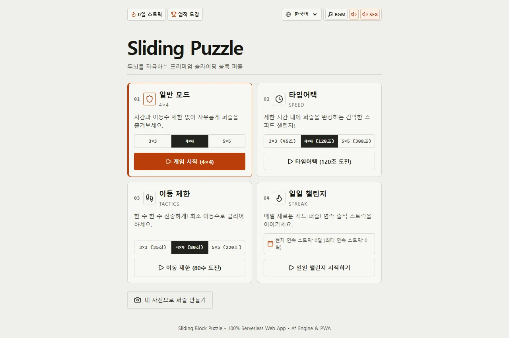
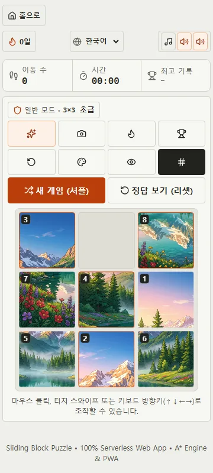
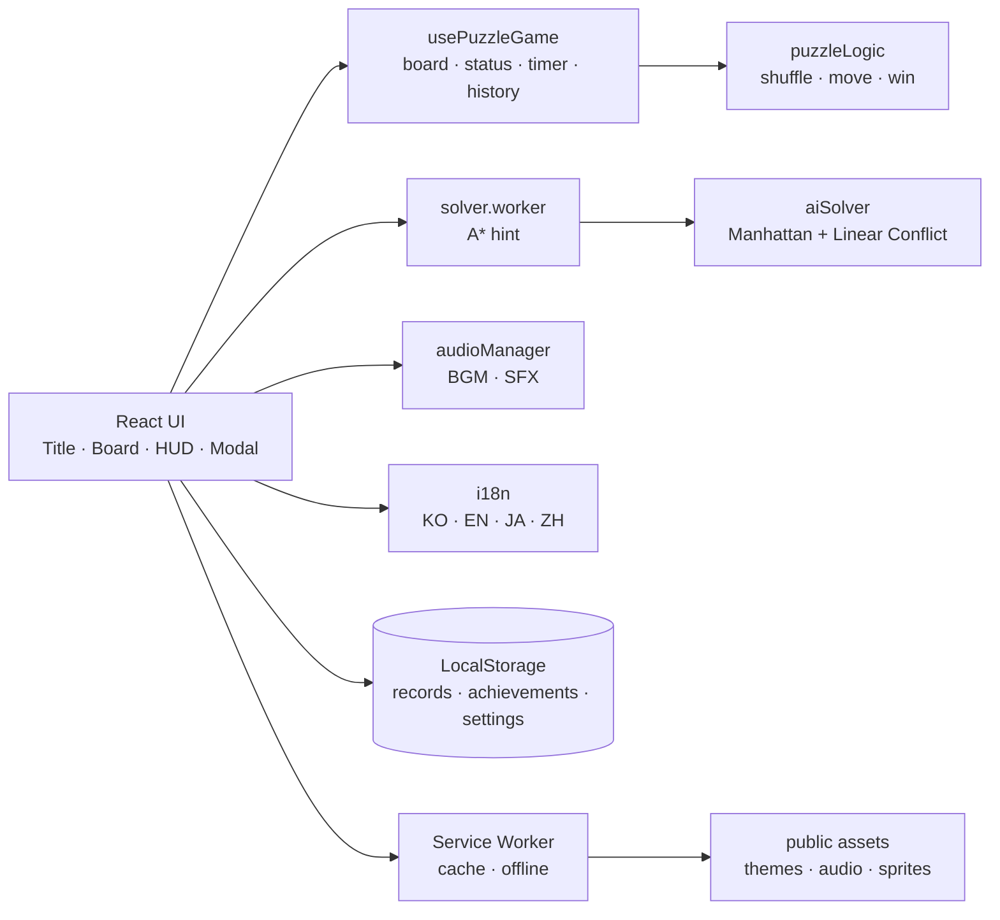

# Sliding Block Puzzle

React와 TypeScript로 만든 클라이언트 사이드 슬라이딩 퍼즐(N-Puzzle) 웹 앱입니다. 3×3·4×4·5×5 보드에서 타일을 밀어 목표 배열을 완성합니다. 별도 백엔드 없이 브라우저에서 동작하며, 게임 기록·설정·업적은 LocalStorage에 저장합니다.

- **참여자**: NewplayerKOR
- **현재 버전**: 1.4.0
- **저장소**: <https://github.com/NewplayerKOR/sliding-puzzle-web>
- **플레이**: <https://sliding-puzzle-web.vercel.app>

> Vercel 프로젝트가 pause 상태이면 사이트가 열리지 않을 수 있습니다.

---

## 1. 주요 기능

| 구분 | 내용 |
| :--- | :--- |
| **코어 게임** | 3×3·4×4·5×5 난이도, 풀이 가능한 셔플, 클릭·키보드·터치 스와이프 조작, 같은 행/열 멀티 타일 슬라이드, 1수 Undo |
| **게임 모드** | Standard, Time Attack(3×3 45초·4×4 120초·5×5 300초), Move Limit(3×3 35회·4×4 80회·5×5 220회) |
| **AI 힌트** | Manhattan 거리 + Linear Conflict A*, 4×4 서브골 리덕션, 5×5 폴백, Web Worker 비동기 처리, 3초 쿨다운 |
| **테마** | 자연·픽셀아트·기하학·동물 4종 테마, 이미지/숫자 모드, 완성본 미리보기 |
| **커스텀 이미지** | JPG·PNG·WebP·GIF 업로드(10MB 이하), 드래그 앤 드롭, 512×512 Canvas 1:1 크롭, 1~3배 줌 |
| **일일 챌린지** | 날짜 기반 Mulberry32 시드 4×4 보드, 하루 1회 완료 기록, 출석 스트릭·월간 캘린더 |
| **업적·별점** | 12종 업적, 다중 달성 순차 토스트, 도감, 난이도·모드·시간·이동 수 기준 3성 별점 |
| **오디오** | BGM 4트랙(Lo-Fi Chill·Zen Nature·Cyber Synth·Jazz Lounge), 5종 SFX, 테마별 음색, 0.6초 콤보 피치 |
| **기록·공유** | 난이도별 최고 시간·이동 수, Canvas 1000×1000 결과 카드, Web Share·클립보드·다운로드 폴백 |
| **PWA·모바일** | 설치·오프라인 캐싱, 업데이트 안내 배너, 100dvh·Safe Area, 터치 제스처, 진동 피드백 |
| **다국어** | 한국어(KO), 영어(EN), 일본어(JA), 중국어(ZH) |
| **디자인** | off-white·concrete·charcoal 중립 팔레트, 단일 신호색, 시스템 폰트·monospace 숫자, 1px 보더, 0/4/8px radius, `prefers-reduced-motion` |

---

## 2. 화면

2026-11-08 QA 검증 시점의 스크린샷입니다.

| 메인 화면 (1280×800) | 게임 화면 (360×800) |
| :---: | :---: |
|  |  |

---

## 3. 기술 스택

| 분류 | 기술 | 버전 | 비고 |
| :--- | :--- | :--- | :--- |
| **Runtime** | Node.js | 24.15.0+ (24.x) 또는 26.0.0+ | `.nvmrc` 26.13.0, `package.json` `engines` |
| **Framework** | React | 19.3.1 | UI 컴포넌트·상태 관리 |
| **Language** | TypeScript | 7.0.2 | strict 모드 |
| **Build** | Vite | 8.3.6 | Rolldown 기반 개발 서버·프로덕션 번들 |
| **Test** | Vitest | 5.1.0 | 유닛·통합 테스트 |
| **DOM Test** | Testing Library | 16.3.3 | React 컴포넌트 테스트 |
| **E2E** | Playwright | 1.65.0 | Chromium 스모크 테스트 |
| **Styling** | Vanilla CSS | - | CSS Grid/Flexbox, 디자인 토큰 |
| **Browser API** | Canvas, Web Audio, Web Worker, Service Worker, Vibration, Web Share | - | 클라이언트 기능 구현 |

---

## 4. 구조

### 4.1 앱 구조

백엔드와 데이터베이스가 없으므로 ERD 대신 앱 구조와 LocalStorage 저장 키를 기록합니다.



### 4.2 LocalStorage

| 키 | 저장 내용 |
| :--- | :--- |
| `sliding_puzzle_best_records` | 난이도별 최고 시간·이동 수 |
| `sliding_puzzle_achievements`, `sliding_puzzle_achievement_stats` | 업적 달성 상태·진행도·통계 |
| `sliding_puzzle_daily_streak` | 일일 챌린지 완료 날짜·스트릭 |
| `sliding_puzzle_sfx_muted`, `sliding_puzzle_bgm_muted`, `sliding_puzzle_sfx_vol`, `sliding_puzzle_bgm_vol`, `sliding_puzzle_current_bgm`, `sliding_puzzle_auto_theme_bgm` | 오디오 설정 |
| `sliding_puzzle_lang` | 선택 언어 |
| `sliding_puzzle_custom_image` | 커스텀 퍼즐 이미지 |

저장소 접근 차단·손상 JSON·스키마 불일치는 공통 storage 래퍼에서 흡수하고 기본값으로 폴백합니다.

### 4.3 코어 알고리즘

**풀이 가능성**

| 그리드 | 조건 |
| :--- | :--- |
| 홀수(3×3, 5×5) | 반전수(Inversion Count)가 짝수 |
| 짝수(4×4) | 반전수 + 하단 기준 빈 슬롯 행 번호의 합이 홀수 |

**A\* 힌트**

$$h(n) = h_{\text{manhattan}}(n) + 2 \times C_{\text{linear}}(n)$$

- Manhattan 거리와 Linear Conflict를 결합합니다.
- 4×4는 행·열 서브골로 축소한 뒤 3×3 A*로 해결합니다.
- 5×5는 탐색 예산과 폴백을 적용하고, 계산은 Web Worker에서 수행합니다.

### 4.4 주요 디렉터리

```text
src/
├── components/   # Board, Controls, Header, Modal, Title, Achievement, PWA
├── hooks/        # usePuzzleGame, useAudio, useAssetPreloader, useModalFocusTrap
├── utils/        # puzzleLogic, aiSolver, audioManager, dailyChallenge, storage 등
├── workers/      # solver.worker.ts
├── i18n/         # KO/EN/JA/ZH 번역
├── styles/       # 디자인 토큰·전역/컴포넌트 스타일
├── test/         # Vitest setup
├── types/        # TypeScript 타입
├── App.tsx
└── main.tsx
```

---

## 5. 테스트 및 검증

2026-11-08 기준 결과입니다.

| 항목 | 결과 |
| :--- | :--- |
| 유닛·통합 테스트 | **29개 파일 / 183개 케이스 PASS** |
| 타입 검사 | **0 Errors** |
| 프로덕션 빌드 | **Vite 8.3.6 성공** |
| E2E | **Playwright Chromium 4/4 PASS** |
| Lighthouse | 8개 화면 접근성·Best Practices·SEO **1.0** |

- Node.js 26.13.0에서도 별도 `NODE_OPTIONS` 없이 `npm test`가 통과합니다.
- 실제 모바일 실기기·Safari/Firefox·스크린리더 검증은 수행하지 않았습니다.

---

## 6. 문서

| 문서 | 내용 |
| :--- | :--- |
| [root/AGENTS.md](./root/AGENTS.md) | 프로젝트 규칙·작업 라이프사이클·환경 요약 |
| [root/TASKS.md](./root/TASKS.md) | 진행·대기·보류 업무와 완료 기록 |
| [root/FEATURES.md](./root/FEATURES.md) | 구현·검증된 기능 카탈로그 |
| [root/DESIGN_SYSTEM.md](./root/DESIGN_SYSTEM.md) | 디자인 토큰·가독성·금지·지양 목록 |
| [root/DEPLOYMENT.md](./root/DEPLOYMENT.md) | 배포·캐시·업데이트·롤백 절차 |
| [roles/](./roles) | PM·DEV·QA 역할별 행동 수칙 |
